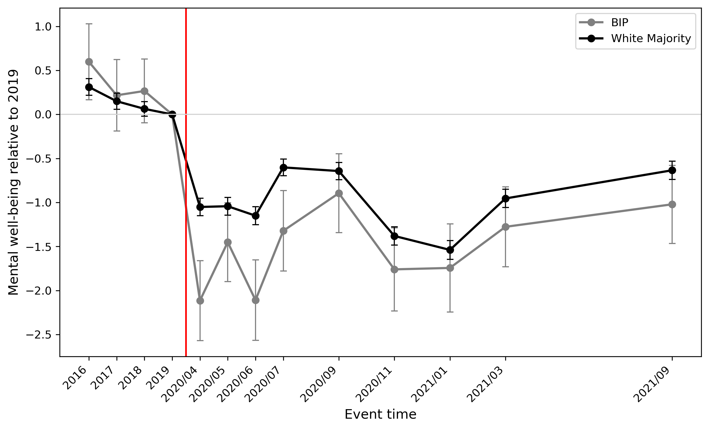

# Ethnic Inequalities in Mental Well-Being at the Onset of COVID-19

**Evidence from the UK**

**Shih-Hsueh Lee** · MSc thesis in Economics, University of Copenhagen (June 2026) · Supervisor: Mette Gørtz

**[Read the full thesis (PDF)](Lee_2026_MSc_thesis.pdf)**

> **Language:** Stata (data and estimation) · Python (tables and figures) · **Data:** Understanding Society (SN 6614) & COVID-19 Study (SN 8644)

---

## Overview

Did ethnic minority groups in the UK suffer larger declines in mental well-being when the
COVID-19 pandemic began? This project answers that question using longitudinal survey data
covering the 2019 pre-pandemic baseline and the first months of the pandemic.

The analysis compares the white majority (WM) in the UK against two alternative minority
definitions:

- **BAME** — a broad Black, Asian, and other minority ethnic category
- **BIP** — a narrower group of Bangladeshi, Indian, and Pakistani respondents

**Main findings.** The broad BAME–WM comparison shows no strong evidence of a large or
persistent widening of the mental well-being gap. A larger, statistically significant gap
emerges once the minority group is restricted to BIP respondents. Decompositions point to
age composition and economic vulnerability — particularly employment and financial
conditions — as important correlates of the gap. Event-study estimates show a sharp widening
of the BIP–WM gap in the early pandemic months, followed by partial but incomplete
convergence.

These results highlight how sensitive conclusions about health inequality are to the choice
of ethnic categorisation: aggregating minority groups into a single BAME category masks
substantial heterogeneity.



*Figure 3: mental well-being of BIP and White majority respondents relative to the 2019
baseline. The vertical line marks the start of the COVID-19 Study period.*

---

## Research design

| Component  | Approach                                                        |
| ---------- | --------------------------------------------------------------- |
| Outcome    | GHQ-12 mental well-being score                                  |
| Comparison | 2019 pre-pandemic baseline vs. April 2020                       |
| Method 1   | Oaxaca–Blinder decomposition of the change in GHQ-12            |
| Method 2   | Event study tracing ethnic gaps before and after pandemic onset |
| Groups     | White majority vs. BAME; white majority vs. BIP                 |

---

## Where to find each table and figure

| Thesis | Stata (`do/`) | Python (`ipynb/`) | Output (`out/`) |
| --- | --- | --- | --- |
| Figure 1 | `Figure_1/` | `figure1_descriptive_trends.ipynb` | `Descriptive_trends/` |
| Table 1 | `02_table1_ghq_change.do` | `Tables/table1_ghq_by_ethnicity.ipynb` | `Tables/descriptive_tables/` |
| Tables 2–7 | `Proportions/table2_…` – `table7_…` | `Tables/table2_…` – `table7_…` | `Tables/*_tables/ethnicity_*_shares*.tex` |
| Tables 8–9 | `04_decompose_*.do`, `05_decomposition_tables.do` | `table8_9_decomposition.ipynb` | `Decomposition/` |
| Figures 2–5, Tables B.1–B.4 | `Event_study/` | `Event_study/` | `Event_study/` |
| Tables A.1–A.14 | `03a_…` – `03f_…` | `Appendix/appendix_a1_a14.ipynb` | `Tables/*_tables/Table_*.tex` |
| Tables C.1–C.2 | `06_appendix_c1_c2_bame.do` | `Appendix/appendix_c1_c2_bame.ipynb` | `Appendix/BAME/` |
| Tables C.3–C.4 | `06_appendix_c3_c4_bip.do` | `Appendix/appendix_c3_c4_bip.ipynb` | `Appendix/BIP/` |

---

## Repository structure

Most analysis steps are estimated twice — once for the BAME definition and once for BIP —
which is why several do-files come in pairs (`_bame` / `_bip`).

```
Thesis2026/
├── do/                                  # Stata: data preparation and estimation
│   ├── 00_combine_panel.do              # Combine the UKHLS waves and the COVID-19 Study
│   ├── 01_standardise_ghq.do            # Seasonally adjust, standardise and invert GHQ-12;
│   │                                    #   apply COVID weights
│   ├── 02_add_factors_{bame,bip}.do     # Sample selection and covariates
│   ├── 02_table1_ghq_change.do          # Table 1 — change in GHQ-12 by ethnic group
│   ├── 03a_employment_{bame,bip}.do     # 03a–03f: change in GHQ-12 by each factor group
│   ├── 03b_financial_{bame,bip}.do      #   (Appendix A)
│   ├── 03c_housing_{bame,bip}.do
│   ├── 03d_health_{bame,bip}.do
│   ├── 03e_household_{bame,bip}.do
│   ├── 03f_demographics_{bame,bip}.do
│   ├── 04_decompose_{bame,bip}.do       # Oaxaca–Blinder decomposition
│   ├── 05_decomposition_tables.do       # Tables 8–9
│   ├── 06_appendix_c1_c2_bame.do        # Tables C.1–C.2 (BAME)
│   ├── 06_appendix_c3_c4_bip.do         # Tables C.3–C.4 (BIP)
│   ├── Event_study/                     # Figures 2–5, Tables B.1–B.4:
│   │                                    #   BAME, BIP, BIP by sex, BIP by baseline finances
│   ├── Figure_1/                        # Seasonal adjustment, weighting and Figure 1
│   └── Proportions/                     # Tables 2–7 — group shares by factor
├── ipynb/                               # Python: turn Stata output into tables and figures
│   ├── figure1_descriptive_trends.ipynb # Figure 1
│   ├── table8_9_decomposition.ipynb     # Tables 8–9
│   ├── Tables/                          # Tables 1–7
│   ├── Event_study/                     # Figures 2–5, Tables B.1–B.4
│   └── Appendix/                        # Tables A.1–A.14 and C.1–C.4
├── out/                                 # Generated tables and figures
│   ├── Tables/                          # Tables 1–7 and A.1–A.14
│   ├── Descriptive_trends/              # Figure 1 and other descriptive trends
│   ├── Decomposition/                   # Tables 8–9 (.tex tables, tidy .csv)
│   ├── Event_study/                     # Figures 2–5, Tables B.1–B.4
│   └── Appendix/                        # Tables C.1–C.4 (BAME and BIP subfolders)
├── Lee_2026_MSc_thesis.pdf
├── .gitignore
└── README.md
```

**Order of execution:** `00` → `01` → `02` → `03a`–`03f` → `04` → `05` → `06`, then the
`Event_study/`, `Figure_1/` and `Proportions/` folders. Output is written to `out/` and
formatted for the thesis in `ipynb/`.

---

## How to run

**Requirements**

- Stata SE or MP (`00_combine_panel.do` sets `maxvar` to 32,767) with three packages from
  SSC: `ssc install oaxaca`, `ssc install ftools` and `ssc install reghdfe`
- Python 3 with `pandas`, `numpy`, `matplotlib` and `openpyxl`

**Steps**

1. Download SN 6614 and SN 8644 from the UK Data Service (see [Data](#data)).
2. At the top of `do/00_combine_panel.do`, set the four paths: `p6614` and `p8644` (the raw
   data), `work` (intermediate files) and `out` (this repository's `out/` folder).
3. Run the do-files in the order above, in the same Stata session: the later files use the
   paths set in `00`.
4. Run the notebooks in `ipynb/`. They contain absolute paths from my computer, so change
   them to your own folders first.

---

## Data

This project uses two restricted-access datasets from the UK Data Service:

| Study | Title | Access level |
| --- | --- | --- |
| **SN 6614** | Understanding Society: UK Household Longitudinal Study | Safeguarded (EUL) |
| **SN 8644** | Understanding Society: COVID-19 Study | Safeguarded (EUL) |

**No data are included in this repository.** Both datasets are Safeguarded and governed by
the UK Data Service End User Licence, which prohibits redistribution of the data or of any
dataset derived from them. Only aggregated statistical output (tables and figures in `out/`)
is published here.
